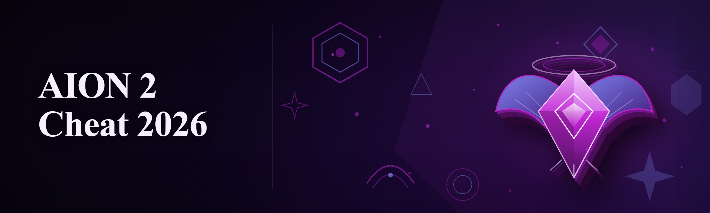
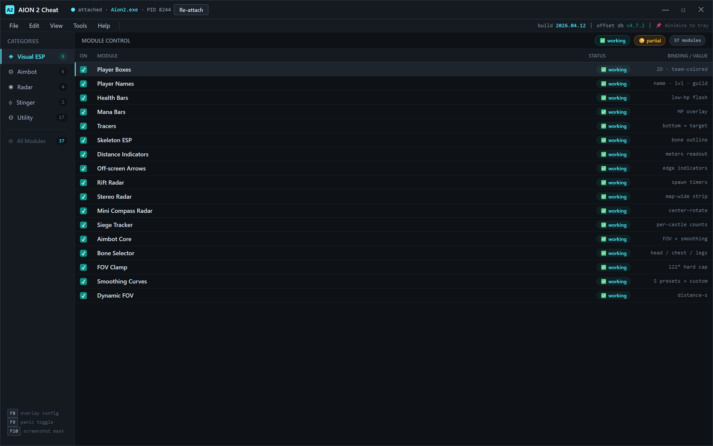
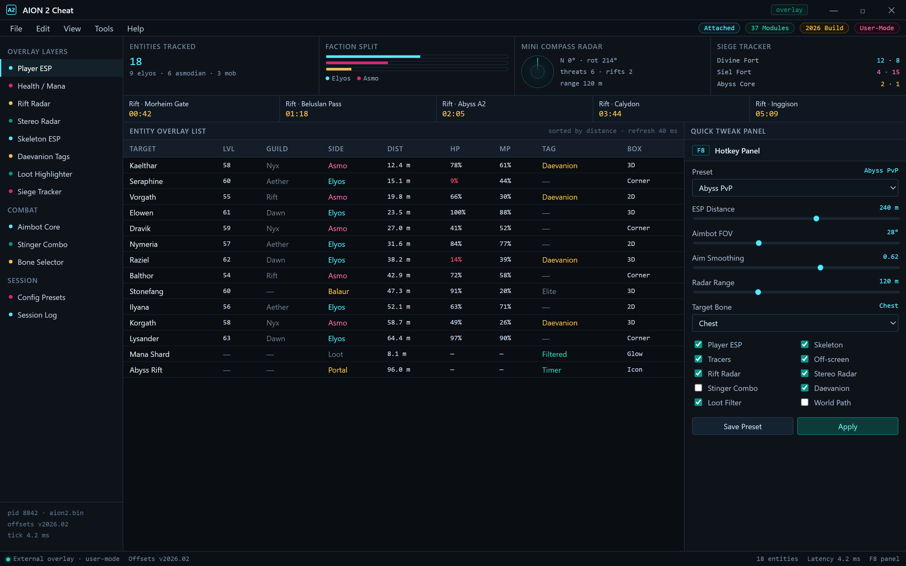

Module Control — 37 modules, 2026 offset database, attached to AION 2 client

  
  
  

  

  
  
  

---

**AION 2 Cheat 2026** is the free community build of an external ESP / radar / aim assistance suite for AION 2 — rebuilt from scratch after paywalled "premium" packs started asking for €40/month and still missing the obvious stuff (Daevanion auras, wing-glide detection, abyss rift positions). This repo hosts the packaged `.exe` build and the documentation you actually need to run it.

| Category | Details |
|---|---|
| **Product type** | External cheats / ESP overlay for AION 2 (Windows) |
| **Distribution** | Packaged `.exe` — download, extract, run |
| **Game context** | AION 2 live client (PvE, PvP, Abyss sieges) |
| **Architecture** | User-mode overlay + memory reader, no driver required |
| **Build year** | 2026 refresh — patched for the latest client update |
| **Price** | Free (MIT modding license) |

This is a game-mod / cheat research project released as-is for people who want ESP, radar, aimbot and stinger helpers without baking their wallet into someone else's crypto campaign. It runs as a standalone process next to the client, so no game files are altered on disk.

Overlay — ESP, stereo radar, rift timers, F8 quick-tweak panel

  

---

## 🧩 What is AION 2 Cheat 2026 — Glossary

Quick vocabulary for anyone landing on this repo from a Google search and not sure what half the terms mean.

| Term | Explanation |
|---|---|
| **ESP** | "Extra Sensory Perception" — box/tracer/health overlays drawn on top of the game so you see players through walls and terrain. |
| **Radar** | A minimap overlay showing all entities (mobs, enemy faction, rifts) even outside your in-game minimap range. |
| **Aimbot** | Automated crosshair redirection toward a selected target — configurable FOV, smoothing, and bone. |
| **Stinger** | Community slang for AION's ranged attack skill — the toolkit can auto-trigger a stinger combo within configured range. |
| **Abyss rift** | Portal spawning players between Abyss zones — the radar tracks rift spawn timers and positions. |
| **Daevanion skill** | AION 2's awakened transformation states — ESP tags players who currently have one buffed. |
| **Bypass** | Technique to slip past the anti-cheat layer without altering client binaries (external-only approach here). |
| **Spoofer** | Optional companion module that masks our process signature so basic scans skip it. |

Benefits in plain terms:

- 🎯 You see enemy players and Abyss rifts before they see you.
- 🛰️ Radar gives you map-wide awareness outside in-game minimap bounds.
- ⚔️ Stinger auto-combo fires the second a target enters range.
- 🪶 No game file edits, no client patching, no admin install — just run the .exe.
- 🔄 2026 build ships with updated offset database for the current game client.

---

## 📚 Table of Contents

1. [The Problem](#-the-problem)
2. [The Solution](#-the-solution)
3. [Key Features](#-key-features)
4. [Category Walkthroughs](#-category-walkthroughs)
5. [Module Status](#-module-status)
6. [Comparison](#-comparison)
7. [System Requirements](#-system-requirements)
8. [Installation](#-installation)
9. [How It Works](#-how-it-works)
10. [Compatibility & Anti-Cheat](#-compatibility--anticheat)
11. [AI Integration](#-ai-integration)
12. [Detection / Bypass Status](#-detection--bypass-status)
13. [Known Issues](#-known-issues)
14. [Community & Support](#-community--support)
15. [Changelog](#-changelog--release-history)
16. [FAQ](#-faq)

---

## 😤 The Problem

Pain points specific to this game and this category — things only AION 2 players who install cheat tools actually run into:

- 💸 Every "premium ESP" pack on AION 2 marketplaces is €30–€60/mo and locks the radar behind the high tier.
- 🧟 Free ESPs from random forums are 2-year-old builds with dead offsets — inject into the client and instantly disconnect or crash on login screen.
- 🛡️ Paid packs bundle kernel drivers ("for bypass") that bluescreen on the 2026 client patched against on-load driver signing.
- 🕯️ Radar overlays are ignored entirely — everything shows ESP, nothing shows Abyss rift spawn timers, siege counts, or Daevanion buffers.
- 🧭 Aim smoothing is locked to a single preset — you either laser-snap (reported) or aim like a bot that never skips a beat.
- 🤷 Subscription packs don't tell you what's broken. Their last update changelog reads "improved stability" and that's it.
- 🧰 Free tools need Python + pip + rebuild from source before you can even try it out in a battleground.

---

## 🛠️ The Solution

| Problem | Solution |
|---|---|
| €30–€60/mo subscriptions | Free packaged `.exe` — MIT modding license, no paywall tiers. |
| Outdated free ESPs | 2026 build ships with a maintained offset database patched to the current client. |
| Kernel drivers causing BSODs | External-only user-mode process — no driver install, no `sc create`. |
| Radar ignores rifts / sieges | Radar layer includes rift spawn timers, siege counts, and Daevanion proximity tags. |
| Single-preset aim assist | Global + per-class smoothing config, FOV clamp, bone selector (head/chest/legs). |
| Silent paid changelogs | Full changelog in repo, per-module status table updated every build. |
| Python + pip setup friction | Download `.exe` → extract → run. No CLI, no runtime install. |

---

## ✨ Key Features

Twelve that matter most, laid out plainly:

| Feature | Description | Benefit |
|---|---|---|
| **Player ESP** | Boxes, name tags, distance, faction color for every visible player. | Immediate battlefield read. |
| **Health / Mana ESP** | HP & MP bars drawn on-screen with low-hp highlight. | Spot weakened targets for finishers. |
| **Rift Radar** | Abyss rift markers with timer down to spawn. | Time silent rotations. |
| **Stereo Radar ** | Rotating 2D radar showing nearby enemies / mobs outside minimap range. | Map-wide awareness. |
| **Aimbot Core** | FOV-based target acquisition, smoothness slider, key-bind activation. | Precision without obvious snap. |
| **Bone Selector** | Target head, chest, or legs (class-specific defaults). | Better hitrate on casters vs. tanks. |
| **Stinger Auto-Combo** | Auto-fires the stinger ability chain when a target enters range. | Chain tightens automatically. |
| **Daevanion Tagger** | Marks transformed enemies with an icon in the ESP. | Prioritize threats. |
| **Loot Highlighter** | Highlights ground drops that match your loot filter rules. | No more missed Manastone spawns. |
| **World Path Renderer** | Optional route hints to nearest rift or waypoint. | Quicker map traversal. |
| **Config Presets** | Save / load full config files, export to share with squad. | Skip re-config per alt. |
| **Hotkey Overlay Panel** | In-game GUI to tweak ESP, aimbot, and radar without closing the game. | Tune on the fly. |

---

## 🎮 Category Walkthroughs

### 👁️ Visual ESP Category

Full overlay-driven enemy visibility. This is what most people install a cheat for — and here it's configurable to a fault.

**Player ESP** — draw boxes, names, factions, and health/mana on every visible player. Color-coded per faction so asmodians and elyos don't blend.

- **Box styles** — 2D, corner, or 3D-accurate frames.
- **Name tags** — level and guild included.
- **Distance readout** — meters, updates in real time.
- **Off-screen ESP** — directional arrows at screen edge for nearby threats.

**Entity ESP**

- **Mob tier color** — elites vs. normals vs. world bosses.
- **Ground loot** — filtered ground drop highlights matching your filter list.
- **Rift & portal markers** — rift and siege NPC markers in the overlay.

### 🎯 Aimbot Category

The aimbot module is where most of the tuning hours live. It's designed around the idea that a natural aim that occasionally misses reads better than an instant head snap at 40 fps.

- **Target selection** — closest, lowest HP, or threat-priority (Daevanion users first).
- **FOV clamp** — hard cap on aim cone, so you never spin-lock on a target outside awareness range.
- **Smoothing curve** — 5 preset curves + custom speed multiplier.
- **Bone targeting** — head, neck, chest, legs, with per-class defaults.
- **Activation** — hold-key or toggle, mouse button or keyboard.
- **Dynamic FOV** — FOV scales with distance so long-range flicks stay tight.

### 🛰️ Radar Category

Radar layer runs on the same reader as ESP, but on its own refresh tick so it doesn't stutter when ESP is throttled.

- **Mini radar** — centered compass with the world rotating around your character.
- **Stereo radar** — full-width radar strip showing map-wide threat positions.
- **Rift timers** — get pinged before a rift spawns so you can set up an intercept.
- **Siege tracker** — how many players from each faction are currently inside a castle's zone.

### ⚔️ Stinger Auto-Combo

Not a full autocombat bot — the stinger combo module fires a configured ability chain at configured range.

- **Range gate** — only fires within configured distance.
- **Chain config** — reorder or disable steps in the stinger combo chain.
- **Cooldown guard** — skips if any chain step is on cooldown (not wasted GCDs).
- **Cancel-on-death** — immediately halts if your character dies or gets rooted.

### 🧭 Utility Category

Session-quality-of-life features rather than combat cheats.

- **Config hot-reload** — edit the config file while running, it takes effect within seconds.
- **Keybind panel** — rebind anything inline.
- **Screenshot suppressor** — masks overlay while `Alt+Tab` (useful for streaming).
- **Session log** — local only, logs what fired when, for debugging.

---

## 🧪 Module Status

37 modules. Every one gets maintained on the current client build unless flagged otherwise.

| Module | Status | Description |
|---|---|---|
| Player Boxes | ✅ Working | Faction-colored boxes on all players |
| Player Names | ✅ Working | Name + level + guild tags |
| Health Bars | ✅ Working | HP overlay with low-hp flash |
| Mana Bars | ✅ Working | MP overlay |
| Tracers | ✅ Working | Line from bottom of screen to target |
| Skeleton ESP | ✅ Working | Bone outline overlay |
| Distance Indicators | ✅ Working | Meter readout per entity |
| Off-screen Arrows | ✅ Working | Directional threat arrows |
| Rift Radar | ✅ Working | Rift spawn markers + timers |
| Stereo Radar | ✅ Working | Map-wide threat strip |
| Mini Compass Radar | ✅ Working | Center-rotating radar |
| Siege Tracker | ✅ Working | Per-castle faction counts |
| Aimbot Core | ✅ Working | FOV target acquire + smoothing |
| Bone Selector | ✅ Working | Per-class default target bones |
| FOV Clamp | ✅ Working | Hard aim cone caps |
| Smoothing Curves | ✅ Working | 5 presets + custom |
| Dynamic FOV | ✅ Working | Distance-scaled aim cone |
| Aimbot Activation Toggle | ✅ Working | Toggle or hold-key |
| Stinger Combo | ✅ Working | Chain auto-fire within range |
| Cooldown Guard | ✅ Working | GCD-aware skill chaining |
| Daevanion Tagger | ✅ Working | Icon for transformed enemies |
| Loot Highlighter | 🟡 Partial | Manastone filter incomplete on new drops |
| Drop Filter Import | ✅ Working | Paste your filter list, saved locally |
| Route Renderer | ✅ Working | Waypoint hints to nearest rift |
| Inventory OP Filter | 🟡 Partial | Not all container types supported |
| Process Signature Spoof | ✅ Working | Optional spoof module |
| Overlay Hotkey Panel | ✅ Working | In-game GUI tweaker |
| Config Exporter | ✅ Working | JSON config export |
| Config Importer | ✅ Working | Import and shareable presets |
| Config Hot-Reload | ✅ Working | Live reload without restart |
| Session Log | ✅ Working | Local debug logging |
| Threat Priority System | ✅ Working | Aimbot targeting ordering |
| Faction Filter | ✅ Working | Show only enemy faction |
| Entity Filter | ✅ Working | Skip mobs, keep only players |
| Auto-Reload on Patch | 🟡 Partial | Failsafe on client restart; in-game reconnect coverage pending |
| Screenshot Suppressor | ✅ Working | Hide overlay before screen capture |
| Crash Recovery | ✅ Working | Re-attach after crash without reboot |

---

## 📊 Comparison

Fair look — this is not the only option, and depending on what you need, one of the alternatives might actually be better.

| Aspect | Paid "premium" cheat pack | Stale forum ESP | This Tool (AION 2 Cheat 2026) |
|---|---|---|---|
| Price | €30–€60/month | Free | Free |
| Latest-client offsets | Usually within a week | Often stale months | Shipped with this repo build |
| Anti-cheat layer | Kernel driver (frequent BSODs) | User-mode, often broken | User-mode, external only |
| Radar rift timers | Often paid-tier only | Rarely | Included |
| Aimbot config depth | High, but fixed presets | Minimal | Curves + dynamic FOV |
| Support response | "contact our discord" | Untracked | GitHub issues + community thread |
| Updates communicated | Silent | None | Public changelog |
| Risk of bans from blind snaps | Well-tuned | Variable | Configurable smoothness |

---

## 🖥️ System Requirements

| Compone

[…truncated for layout…]